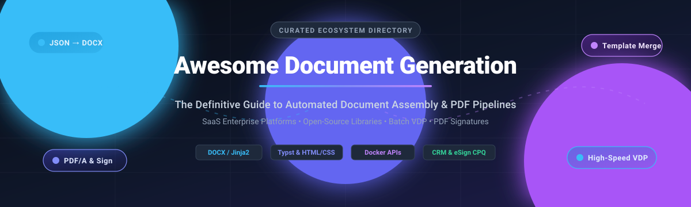

# 📄 Awesome-Document-Generation

  
  
  
  
  
  

  

  <strong>A curated collection of leading SaaS platforms and open-source libraries for automated document assembly, template merging, PDF generation, and high-volume variable data printing (VDP).</strong>

  <a href="#%EF%B8%8F-sector-overview--market-dynamics">Sector Dynamics</a> •
  <a href="#-saashosted-platforms">SaaS Platforms</a> •
  <a href="#-open-source-github-projects">Open-Source Projects</a> •
  <a href="#%EF%B8%8F-key-frameworks--architecture-patterns">Architecture Patterns</a> •
  <a href="#-star-history">Star History</a> •
  <a href="#-support--community">Support</a>

---

## 📌 Introduction & Scope

Welcome to **Awesome Document Generation**, the premier developer and enterprise guide for automated document generation and template-based publishing. In today's cloud-native landscape, business transactions—ranging from customer onboarding, legal contracts, NDAs, dynamic invoices, and compliance audits to variable print statements—require deterministic, pixel-perfect document rendering.

This repository tracks high-performance **SaaS document automation suites** as well as robust **open-source template engines** (supporting DOCX, PDF, HTML/CSS, Jinja2, Typst, and Markdown). Whether you are an enterprise architect integrating Salesforce/Workday document flows or an engineer compiling microservices to generate thousands of PDFs per second, this list provides structured benchmarks, transparent pricing, and repository insights.

---

## 📑 Table of Contents

- [📊 Sector Overview & Market Dynamics](#%EF%B8%8F-sector-overview--market-dynamics)
- [☁️ SaaS/Hosted Platforms](#-saashosted-platforms)
- [💻 Open-Source GitHub Projects](#-open-source-github-projects)
- [🧩 Additional Strong Open-Source Libraries](#-additional-strong-open-source-libraries)
- [🏗️ Key Frameworks & Architecture Patterns](#%EF%B8%8F-key-frameworks--architecture-patterns)
- [📈 Star History](#-star-history)
- [🤝 How to Contribute](#-how-to-contribute)
- [💖 Support & Community](#-support--community)
- [⚖️ Disclaimer & License](#%EF%B8%8F-disclaimer--license)

---

## 📊 Sector Overview & Market Dynamics

The global **document generation and automation software market** is estimated at approximately **$3.5 billion to $4.4 billion** (projected to surpass **$10 billion to $17 billion** as end-to-end document workflow automation, e-signatures, and Document AI solutions expand at a 10–15% CAGR).

The sector exhibits a **hybrid market structure: concentrated at the enterprise top tier**, where dominant platform incumbents (Adobe, Workday, DocuSign, Conga) command major enterprise-wide deployments and deeply integrated CRM/ERP workflows; **yet highly fragmented across middle and lower tiers**, where a multitude of specialized ISVs, vertical-specific point solutions, and open-source engines compete to deliver tailored template assembly and developer APIs.

---

## ☁️ SaaS/Hosted Platforms

The following table summarizes prominent SaaS platforms for template-driven document creation, sorted descending by enterprise scale (Revenue / Valuation):

| Platform | 🏢 Scale (Revenue / Valuation) | 💵 Starting Pricing | ⏱️ Free Tier / Trial Limits | 📝 Description |
| :--- | :--- | :--- | :--- | :--- |
| **[Adobe Acrobat Sign](https://www.adobe.com/sign.html)** | ~$23.8B revenue / ~$105B market cap | $12.99/user/month (Acrobat Standard, annual commitment) | 30-day free trial for Acrobat Sign Enterprise (no credit card required) or 7-day free trial for Acrobat Pro | E-signature and enterprise document generation suite integrated into Adobe's document workflow ecosystem. |
| **[Workday Document Generation](https://www.workday.com/)** | ~$8.5B revenue / ~$52B market cap | ~$34 to $100+/employee/year (Core HCM modular bundle) | No self-serve free trial; guided sandbox/evaluation tenant provided via custom enterprise demo | Native document generation within Workday suite producing automated offer letters, statements, and contracts from HR/financial records. |
| **[DocuSign Gen](https://www.docusign.com/)** | ~$3.0B revenue / ~$16.5B market cap | $20/user/month (DocuSign Gen add-on for Salesforce; requires paid eSignature base plan) | 30-day free trial for Salesforce AppExchange integration with full product features | Template-based contract and agreement creation directly merged from Salesforce CRM records. |
| **[Nintex DocGen](https://www.nintex.com/)** | ~$230M revenue / $2.0B valuation (TPG acquisition) | ~$5,000/year (enterprise contract bundle) | 30-day free trial with no credit card required | Automated document generation for Salesforce and SharePoint, creating Word, PDF, Excel, and PowerPoint documents from templates. |
| **[SmartIQ](https://www.smartiq.com/)** | ~$110M+ revenue / $1.8B valuation (Cinven buyout) | Enterprise quote (custom contract via AWS Marketplace / direct) | No self-serve free trial; custom proof-of-concept (PoC) and guided evaluation environments available on request | Intelligent, interview-driven document generation and digital forms platform for complex, regulated enterprise workflows. |
| **[airSlate](https://www.airslate.com/)** | ~$200M revenue / $1.25B valuation (Series C) | $399/month (Growth Plan, 10,000 automation credits, unlimited users) | Permanent Free plan limited to 10 credits/month (or 7-day free trial for signNow plans) | No-code document workflow automation platform combining robotic process automation, template generation, and e-signatures. |
| **[Conga Composer](https://conga.com/)** | ~$250M revenue / $1.25B valuation (Thoma Bravo) | ~$35/user/month (custom quote / baseline tier) | 30-day free trial with 10 user licenses included upon production/sandbox installation | High-volume document generation and reporting suite for Salesforce and Microsoft Dynamics merging data into Word, Excel, and PDF. |
| **[PandaDoc](https://www.pandadoc.com/)** | ~$100M ARR / $1.0B valuation (Series C) | $19/user/month (Starter plan, billed annually) | Permanent Free plan limited to 5 document uploads/sends per month, or 14-day free trial of paid plans | Document automation platform combining drag-and-drop template assembly, proposal generation, and native e-signatures. |
| **[Formstack Documents](https://www.formstack.com/)** | ~$50M ARR / $425M growth round (Silversmith/PSG) | $110/month (Starter tier, 150 document merges/month, 2 users, 10 templates) | 14-day free trial with full template building and integration access (no credit card required) | Document automation engine (formerly WebMerge) merging form submissions and external data sources into PDFs and Word documents. |
| **[HotDocs](https://www.hotdocs.com/)** | ~$220M revenue (Mitratech group) / Multi-billion PE | ~$25/user/month (base tier estimate via enterprise quote) | No self-serve free trial; 30-day temporary evaluation license provisioned through sales / demo | Enterprise template authoring and interview-driven document assembly for legal, banking, and insurance organizations. |

---

## 💻 Open-Source GitHub Projects

The following open-source engines and libraries are actively used to construct document assembly engines, batch PDF renderers, and template injection pipelines. Entries are sorted descending by GitHub stargazers count:

- **[typst](https://github.com/typst/typst)**   
  A modern, markup-based typesetting and document compilation system designed to be powerful and easy to learn (Rust, Apache-2.0); combines the layout expressiveness of LaTeX with programmatic styling, native mathematical typesetting, and instant preview compilation. **Leading modern open-source engine for programmatic document authoring, reports, and publication-ready PDFs.**

- **[react-pdf](https://github.com/diegomura/react-pdf)**   
  Modular React-based rendering engine for creating PDF documents directly from declarative JSX components (MIT); runs seamlessly in both Node.js server environments and client-side web browsers with flexbox styling support. **Ideal for web engineering teams generating invoices, dynamic reports, and certificates using React idioms.**

- **[Gotenberg](https://github.com/gotenberg/gotenberg)**   
  A Docker-powered stateless REST API for converting numerous document formats (HTML, Markdown, DOCX, XLSX, PPTX, images) into standard and PDF/A files (MIT); orchestrates headless Chromium, LibreOffice, and PDF engines within a scalable containerized architecture. **The standard microservice foundation for production-grade document conversion and PDF pipelines.**

- **[pdfmake](https://github.com/bpampuch/pdfmake)**   
  Client-side and server-side JavaScript document generation engine using pure declarative JSON document definitions (MIT); supports complex tables, margins, vector graphics, image embedding, custom fonts, and pagination without external binary dependencies. **Battle-tested for client-side invoice and statement generation directly in the browser.**

- **[WeasyPrint](https://github.com/Kozea/WeasyPrint)**   
  Visual rendering engine translating HTML and CSS into print-quality PDF documents (BSD-3-Clause); adheres strictly to W3C standards including CSS Paged Media (`@page`), margins, headers/footers, and page counters. **The definitive Python choice for converting modern CSS/HTML templates into high-fidelity printable business reports.**

- **[docxtemplater](https://github.com/open-xml-templating/docxtemplater)**   
  Template-based document generator for DOCX, PPTX, and XLSX files from Node.js or browser environments (MIT); allows non-developers to edit templates visually in Word or PowerPoint with tag syntax (`{first_name}`, `{#items}...{/items}`), merging JSON payloads without corrupting formatting. **The preeminent TypeScript/JavaScript solution for business document and contract templating.**

- **[gopdf](https://github.com/signintech/gopdf)**   
  Lightweight, dependency-free Go library for generating custom PDF documents from scratch (MIT); provides native TrueType font embedding, UTF-8 unicode text rendering, image drawing, and precise coordinate placement. **High-performance Go utility for generating high-throughput receipts and billing statements.**

- **[docxtpl (python-docx-template)](https://github.com/elapouya/python-docx-template)**   
  The most widely adopted open-source DOCX templating engine (LGPL-2.1); design a document in Word, insert Jinja2-like tags (`{{ variable }}`, ``, ``), and render it from Python with full formatting preservation. Supports tables, images, headers/footers, and complex structures. **The standard foundation for programmatic DOCX generation**—mature, battle-tested, and available via Debian packages.

- **[Carbone](https://github.com/carboneio/carbone)**   
  Fast and versatile report generator converting JSON data into PDF, DOCX, XLSX, ODT, and PPTX documents using LibreOffice as a conversion engine (Apache-2.0); features intuitive placeholder syntax and dynamic formatting filters. **Versatile multi-format document reporting engine for Node.js backends.**

- **[docx-templates](https://github.com/guigrpa/docx-templates)**   
  Template-based Word (`.docx`) report creation engine for Node.js and browsers (MIT); inserts data, loops, conditionals, dynamic images, and custom JavaScript functions directly into Word templates with a clean markup syntax. **Lightweight and modern JavaScript/TypeScript alternative for template-driven DOCX generation.**

- **[open-pdf-sign](https://github.com/open-pdf-sign/open-pdf-sign)**   
  Open-source command-line tool and Java library for cryptographically signing PDF documents (Apache-2.0); supports visual signature placement, timestamping (RFC 3161), digital certificates, and PDF/A compliance. **Essential building block for automated legal and enterprise document signature pipelines.**

- **[gpdf](https://github.com/gpdf-dev/gpdf)**   
  Go library for building PDFs from JSON schemas or Go templates; includes ready-made constructors for invoices, reports, and letters; supports **digital signatures, AES-256 encryption, PDF/A conformance**, page merging, and absolute positioning. **Strong for Go-based backend document pipelines** requiring compliance-grade output.

- **[unlawful-assembly](https://github.com/splittist/unlawful-assembly)**   
  Open-source client-side web application for survey-driven document assembly; creators design surveys, upload DOCX templates, map fields visually, and bundle into ZIP packages; end users complete the survey and generate customized DOCX via docxtemplater. TypeScript/Survey.js/docxtemplater stack. **The most complete open-source no-code document assembly workflow**—runs entirely in the browser with no server dependency.

- **[Aldina](https://github.com/clbrge/aldina)**   
  Open-source engine for producing **on-brand, print-grade documents**—letters, reports, decks, invoices, one-pagers—from content and a theme (AGPL-3.0 with commercial option). Pipeline: ChoirMark → compose into theme grammar → **gate (admit/reject based on fit, contrast, hierarchy)** → project to PDF. Deterministic layout with bounded LLM checkpoints; the gate refuses pages that don't pass hard checks rather than shipping broken output. **The most sophisticated open-source approach to print-quality branded document generation**, with a novel quality-gate architecture.

---

## 🧩 Additional Strong Open-Source Libraries

- **[docxtpl-ng](https://pypi.org/project/docxtpl-ng/)** — Independent MIT-licensed reimplementation of docxtpl; uses `python-docx-ng` and Jinja2 with a typed element tree rather than regex over serialized XML for schema-validated output.
- **[docma](https://pypi.org/project/docma/)** — Python document generator developed at Origin Energy; assembles PDF and HTML documents from templates with dynamic control flow, PDF watermarking, and Vega-lite charts.
- **[pymsword](https://pypi.org/project/pymsword/)** — Python library for DOCX generation with Jinja-like placeholders and group repetition (paragraph, row, cell markers); supports direct DOCX rendering or COM automation.
- **[fullbleed](https://pypi.org/project/fullbleed/)** — Python PDF engine optimized for high-volume variable data printing (VDP); fixed-geometry and reflow bindings rendering hundreds of thousands of distinct invoices per second.
- **[ferropdf](https://pypi.org/project/ferropdf/)** — Fast, self-contained HTML/CSS to PDF renderer built with a Rust core and Python bindings without requiring headless Chromium.

---

## 🏗️ Key Frameworks & Architecture Patterns

When designing custom document generation architectures:
1. **Office-Centric Visual Templating:** Combine **[docxtemplater](https://github.com/open-xml-templating/docxtemplater)** or **[docxtpl](https://github.com/elapouya/python-docx-template)** to empower business operations and legal teams to modify template styles directly in Microsoft Word.
2. **Containerized Document Microservices:** Deploy **[Gotenberg](https://github.com/gotenberg/gotenberg)** as a stateless Docker microservice for reliable HTML/Markdown-to-PDF transformations.
3. **High-Speed Programmatic Typesetting:** Utilize **[typst](https://github.com/typst/typst)** for lightning-fast compilation of complex scientific, financial, or data-dense reports.
4. **Compliance & Integrity Layers:** Ingest rendered PDFs into **[open-pdf-sign](https://github.com/open-pdf-sign/open-pdf-sign)** to affix cryptographic signatures, timestamp tokens (RFC 3161), and produce PDF/A archives.

---

## 📈 Star History

---

## 🤝 How to Contribute

Contributions are welcome and appreciated! To maintain the highest quality:
1. 🍴 Fork this repository.
2. 📝 Add or update entries in `README.md` (ensure links, descriptions, and categories adhere to the existing format).
3. 🔍 Verify licensing, star count, and accurate descriptions.
4. 🚀 Open a Pull Request with a clear, concise summary of the addition.

---

## 💖 Support & Community

If you find this curated ecosystem directory helpful in building your document workflows, automated pipelines, or tech stack evaluations:

- ⭐ **Star** this repository to show your support and keep it visible to fellow developers!
- 🍴 **Fork** and share it with your engineering team or community.
- ☕ **Sponsor & Buy a Coffee:** You can support continuous maintenance and research via the [GitHub Sponsors Dashboard](https://github.com/sponsors/ishandutta2007).

---

## ⚖️ Disclaimer & License

- This is an independent, **community-curated** list — not an endorsement of specific commercial products.
- Document generation platforms handling contracts, financial statements, and PII must adhere to applicable data sovereignty, SOC 2, HIPAA, and GDPR regulations.
- Verify software license terms before commercial deployment (e.g., Apache-2.0, MIT, BSD, LGPL-2.1, AGPL-3.0).

---

  <strong>Made with ❤️ for document automation engineers, legal operations practitioners, and report architects worldwide.</strong>

